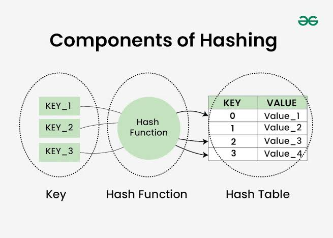

# Hash tables

Widely used in:

- Database indexing
- Cryptography
- Caching systems
- Key-value dictionaries

## Components:

- Key: the key is the input provided to the hash function. It can be a string, number, or any data item.
- Hash Function: Takes the key as input and computes a hash index, which represents the position in the hash table.
- Hash Table: Usually an array of lists. It stores the actual data values associated with their keys. Each value is placed at the index generated by the hash function, allowing quick access and efficient retrieval.



Properties of a good hash function:

- Be efficient, it should compute the hash value quickly.
- Distribute keys uniformly, keys should be spread out evenly across the table, so no index is overloaded.
- Minimize collisions, fewer keys should map to the same index.
- Mantain a low load factor.

## C++ Implementation:

```cpp
#include <iostream>
#include <list>
#include <functional>

using namespace std;

template <typename T>
class Hashing {
    private:
    int buckets;
    list<T> *table;

    public:
    Hashing() {
        buckets = 0;
        table = nullptr;
    }

    Hashing(int buckets) {
        this->buckets = buckets;
        table = new list<T>[this->buckets];
    }

    void insert(T key) {
        int index = hash<T>()(key) % buckets;
        table[index].push_back(key);
    }

    void print() {
        for (int i = 0; i < buckets; i++) {
            cout << "Bucket [" << i << "]: ";
            for (auto j: table[i])
                cout << j << "->";
            cout << "NULL" << endl;
        }
    }

    ~Hashing() {
        delete [] table;
    }
};
```

e.g:

```cpp
int main() {
    Hashing<string> h(10);
    h.insert("Mexico");
    h.insert("USA");
    h.insert("Panama");
    h.insert("Canada");
    h.print();
    return 0;
}
```

OUTPUT:

```
Bucket [0]: NULL
Bucket [1]: USA->NULL
Bucket [2]: NULL
Bucket [3]: Mexico->Panama->NULL
Bucket [4]: NULL
Bucket [5]: NULL
Bucket [6]: Canada->NULL
Bucket [7]: NULL
Bucket [8]: NULL
Bucket [9]: NULL
```
