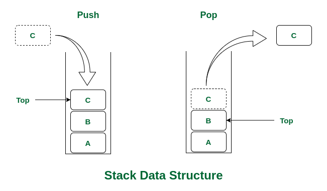
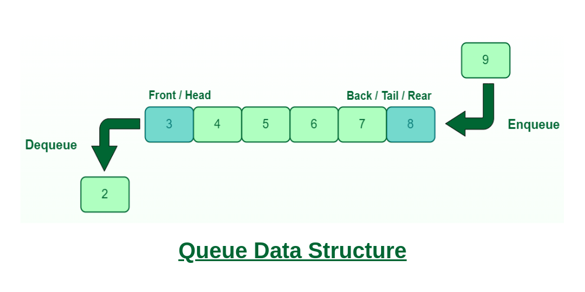
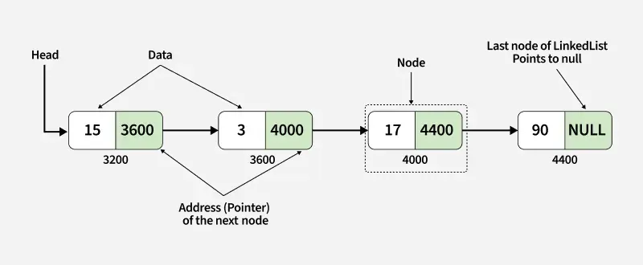
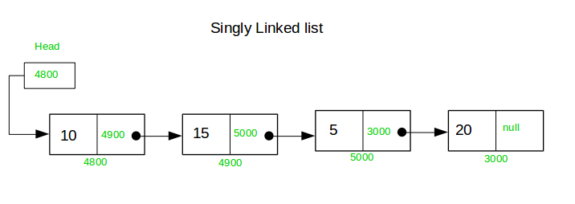
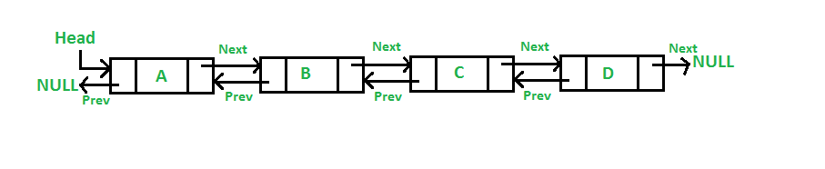
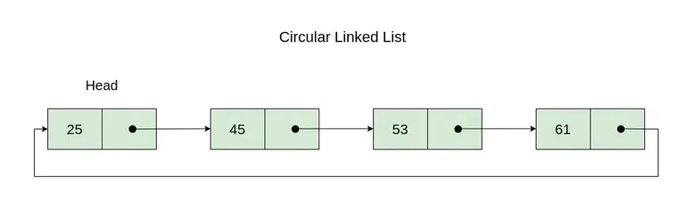

# Linear Data Structures

## Characteristics:

- ### Sequential organization:
  - Elements in a linear data structure are stored one after another in a well-defined sequence.
  - Every element (except the first) has a unique predecessor.
  - Every element (except the last) has a unique successor

    ```cpp
    int nums[4] = {10, 20, 30, 40};
    ```

- ### Order preservation:
  - The sequence in which elements are stored in a linear data structure remains the same when they are accessed or removed.
  - The first element added will be the first one accessed or removed.
  - The last element added will be the last one accessed or removed.

- ### Fixed or Dynamic Size:
  - Refers to whether the size of a linear data structure is predefined or can change during program execution:

  - Fixed Size: some linear data structures, like arrays, have a size that is set when they are created and cannot be changed later

  - Dynamic Size: other linear data structures, like linked lists, can grow or shrink during program execution as elements are added or removed. Dynamic arrays, such as `std::vector`, can also resize automatically when needed.

- ### Efficient Access:
  - It means that elements in a linear data structure can be retrieved quickly, often without needing to search through the entire structure.
  - In arrays, each element is stored at a specific index, so you can directly access any element using that index in constant time `O(1)`.

## Types:

- ### [Arrays](#i-array)
- ### [Stacks](#ii-stack)
- ### [Queues](#iii-queue)
- ### [Linked Lists](#iv-linked-list)

---

## I. Array

- An array is a collection of elements if the same data type, stored in contiguous memory locations.

e.g:

Indexes: `0, 1, 2, 3, 4`

Elements: `[5, 10, 20, 25, 30]`

- Homogeneous elements: all elements within an array must be of the same data type.
- Contiguous memory allocation: all elements of array are stored next to each other in a single continuous block of memory.
- Zero-Based Indexing

### Complexity of Array operations:

- **Accessing elements:** `O(1)`
- **Insertion / Deletion:** appending/deleting an element to the end of an array is usually `O(1)` but insetion at the beginning or any specific index takes `O(n)` time because it requires shifting all of the elements.
- **Searching:** Linear search takes `O(n)`, but other algorithms like binary search (in sorted arrays) take `O(log n)`.

[↑ Back to LDS Types](#types)

---

## II. Stack:

- A stack is a linear data structure that follows the Last-In-First-Out (LIFO) principle, meaning that the last eleemnt added to ther stack is the first one to be removed.



### Stack Operations:

- **push:** inserts element
- **pop:** removes element from the top and stack is returned
- **top:** returns the last inserted element, without removing it
- **size:** returns the size of the stack
- **isEmpty:** returns whether the stack is empty or not

e.g:

```cpp
#include <stack>

int main() {
    stack<float> s;

    for (int i = 0; i < 5; i++)
        s.push(i*10 + 2);

    if (s.empty())
        cout << "The stack is empty" << endl;
    else {
        int size = s.size();
        for (int i = 0; i < size; i++) {
            cout << "The top of the stack is: " << s.top() << endl;
            s.pop();
        }
    }

    cout << s.size() << endl;

    return 0;
}
```

### C++ Implementation:

```cpp
#define max 100

template <typename T>
class Stack {
    private:
    T stack_arr[max];
    int top;

    public:
    Stack() {
        top = -1;
    }

    bool isEmpty() {
        return top == -1;
    }

    bool isFull() {
        return top == (max-1);
    }

    void push(T value) {
        if (isFull()) {
            cout << "The stack is full." << endl;
            return;
        }

        top++;
        stack_arr[top] = value;
    }

    Stack pop() {
        if (isEmpty())
            cout << "The stack is already empty." << endl;
        else
            top--;

        return *this;
    }

    T get_top() {
        if (isEmpty()) {
            cout << "The stack is empty." << endl;
            return T();
        }

        return stack_arr[top];
    }

    int size() {
        return top+1;
    }
};
```

[↑ Back to LDS Types](#types)

---

## III. Queue:

- A queue is a linear data structure based on the First-In-First-Out (FIFO) principle, meaning the element inserted first is also the first to be removed.



### Queue operations:

- `push()` **(Enqueue)**: inserts an element at the rear (end) of the queue
- `pop()` **(Dequeue)**: removes the first (front) element from the queue
- `front()`: returns the element at the front of the queue without removing it
- `size()`: returns the size of the queue
- `empty()`: checks whether the queue is empty

e.g:

```cpp
#include <iostream>
#include <queue>

using namespace std;

void print(queue<int> &q) {
    while (!q.empty()) {
        cout << q.front() << " ";
        q.pop();
    }
    cout << endl;
}

int main() {
    queue<int> q;
    q.push(10);
    q.push(25);
    q.push(20);

    cout << q.size() << endl;
    cout << "Front: " << q.front() << endl;
    cout << "Rear: " << q.back() << endl;

    print(q);
}
```

### C++ Implementation:

```cpp
#define max 100

template <typename T>
class Queue {
    private:
    T queue_arr[max];
    int front;
    int rear;

    public:
    Queue() {
        front = -1;
        rear = -1;
    }

    bool isEmpty() {
        return (front == -1 || front > rear);
    }

    bool isFull() {
        return rear == max-1;
    }

    void enqueue(T value) {
        if (isFull()) {
            cout << "The queue is full." << endl;
            return;
        }

        if (isEmpty())
            front = 0;

        rear++;
        queue_arr[rear] = value;
    }

    void dequeue() {
        if (isEmpty()) {
            cout << "The queue is empty." << endl;
            return;
        }

        front++;
    }

    T Front() {
        if (isEmpty())
            return T();
        return queue_arr[front];
    }

    T Rear() {
        if (isEmpty())
            return T();
        return queue_arr[rear];
    }

    int size() {
        if (isEmpty())
            return 0;
        return rear - front + 1;
    }
};
```

[↑ Back to LDS Types](#types)

---

## IV. Linked List:

- It resembles a chain of nodes. Each node contains two parts: a data field to store the value and a link (reference) to the next node in the sequence.
- Linked lists are not stored inn contiguous memory locations, allowing for dynamic memory allocation and flexible insertion or deletion of elements.



- Node: Each element in a linked list is stored inside a node, which has two parts:
  - Data: Holds the actual value of the element.
  - Next Pointer (Link): Points to the next node in the list.
- Head: The first node of the linked list. It acts as the entry point for accessing and traversing the list.
- Tail: The last node of the linked list. Its next pointer is typically set to NULL, indicating the end of the list.

### Types:

#### Singly Linked List:

- Each node contains data and a pointer to the next node.
- The last node points to NULL.
- Traversal is only possible in one direction (from head to tail).



#### Doubly Linked List:

- Each node has two pointers: one pointing to the next node and one pointing to the previous node.
- This bidirectional structure allows for efficient traversal in both directions.



#### Circular Linked List:

- A circular linked list is a type of linked list in which the first and the last nodes are also connected to each other to form a circle, there is no NULL at the end.



### Linked List Operations:

- Accessing Elements: Accessing a specific element in a linked list takes `O(n)` time since nodes are stored in non contigous locations so random access is if not possible.
- Searching: Searching of a node in a linked list takes `O(n)` time as whole list needs to be traversed in worst case.
- Insertion: Insertion takes `O(1)` time if we are at the position where we have to insert an element.
- Deletion: Deletion takes `O(1)` time if we know the position of the element to be deleted.

e.g:

```cpp
#include <iostream>
#include <list>

using namespace std;

int main() {
    // Declare list and add elements
    list<int> l;
    l.push_front(5);
    l.push_back(10);
    l.push_back(15);
    l.push_back(20);
    l.push_front(3);

    // Declare iterator ptr at beginning of the list
    list<int>::iterator ptr = l.begin();

    // Insert an element
    // -50 at 2
    advance(ptr, 2);
    l.insert(ptr, -50);

    // Replace an element
    *ptr = 25000;

    cout << "Head -> ";
    for (ptr = l.begin(); ptr != l.end(); ptr++)
        cout << *ptr << " -> ";
    cout << "NULL" << endl;

    // Accessing an element
    cout << "Front -> " << l.front() << endl;
    cout << "Back -> " << l.back() << endl;
    cout << "The data of the fourth node is: " << *next(l.begin(), 3) << endl;

    // Find a node
    list<int>::iterator ptr2 = find(l.begin(), l.end(), 15);
    if (ptr2 != l.end())
        cout << "The node is found: " << *ptr2 << endl;
    else
        cout << "The node is not found." << endl;

    return 0;
}
```

OUTPUT:

```
Head -> 3 -> 5 -> -50 -> 25000 -> 15 -> 20 -> NULL
Front -> 3
Back -> 20
The data of the fourth node is: 25000
The node is found: 15
```

### C++ Implementations:

#### Singly Linked List:

```cpp
template <typename T>
class Node {
    public:
    T data;
    Node<T> *next;

    Node() {
        data = 0;
        next = nullptr;
    }

    Node(T data) {
        this->data = data;
        next = nullptr;
    }
};

template <typename T>
class LinkedList {
    private:
    Node<T> *head;

    public:
    LinkedList() {
        head = nullptr;
    }

    void pushFront(T data) {
        Node<T> *new_node = new Node(data);
        if (head == nullptr)
            head = new_node;
        else {
            new_node->next = head;
            head = new_node;
        }
    }

    void pushBack(T data) {
        Node<T> *new_node = new Node(data);

        if (head == nullptr)
            head = new_node;
        else {
            Node<T> *ptr = head;
            while (ptr->next != nullptr)
                ptr = ptr->next;
            ptr->next = new_node;
        }
    }

    void insert(T data, int index) {
        Node<T> *new_node = new Node(data);
        if (head == nullptr)
            head = new_node;
        else {
            Node<T> *ptr = head;
            for (int i = 0; i < index-1; i++)
                ptr = ptr->next;

            new_node->next = ptr->next;
            ptr->next = new_node;
        }
    }

    bool find(T data) {
        if (head == nullptr) return false;

        Node<T> *ptr = head;
        while (ptr != nullptr) {
            if (ptr->data == data) return true;
            ptr = ptr->next;
        }

        return false;
    }

    void popFront() {
        if (head == nullptr)
            cout << "Linked List is empty" << endl;
        else {
            Node<T> *ptr = head;
            head = head->next;
            delete ptr;
        }
    }

    void popBack() {
        if (head == nullptr)
            cout << "Linked List is empty" << endl;
        else {
            Node<T> *ptr = head;
            Node<T> *prev;

            while (ptr->next != nullptr) {
                prev = ptr;
                ptr = ptr->next;
            }

            prev->next = nullptr;
            delete ptr;
        }
    }

    void erase(T data) {
        if (head == nullptr) {
            cout << "Linked List is empty" << endl;
            return;
        }

        Node<T> *ptr = head;
        Node<T> *prev = nullptr;

        while (ptr != nullptr && ptr->data != data) {
            prev = ptr;
            ptr = ptr->next;
        }

        if (ptr == nullptr) {
            cout << "Data not found" << endl;
            return;
        }

        if (prev == nullptr)
            head = head->next;
        else
            prev->next = ptr->next;

        delete ptr;
    }

    void print() {
        Node<T> *ptr = head;
        cout << "Head -> ";
        while (ptr != nullptr) {
            cout << ptr->data << " -> ";
            ptr = ptr->next;
        }
        cout << "NULL" << endl;
    }
};
```

#### Double Linked List:

```cpp
template <typename T>
class Node {
    public:
    T data;
    Node<T> *next;
    Node<T> *prev;

    Node() {
        data = T();
        next = nullptr;
        prev = nullptr;
    }

    Node(T data) {
        this->data = data;
        next = nullptr;
        prev = nullptr;
    }
};

template <typename T>

class DoubleLinkedList {
    private:
    Node<T> *head;

    public:
    DoubleLinkedList() {
        head = nullptr;
    }

    void pushFront(T data) {
        Node<T> *new_node = new Node(data);
        if (head == nullptr)
            head = new_node;
        else {
            new_node->next = head;
            head->prev = new_node;
            head = new_node;
        }
    }

    void pushBack(T data) {
        Node<T> *new_node = new Node(data);
        if (head == nullptr)
            pushFront(data);
        else {
            Node<T> *ptr = head;
            while (ptr->next != nullptr)
                ptr = ptr->next;
            ptr->next = new_node;
            new_node->prev = ptr;
        }
    }

    void insert(T data, int index) {
        Node<T> *new_node = new Node(data);
        if (head == nullptr)
            pushFront(data);
        else {
            Node<T> *ptr = head;
            for (int i = 0; i < index-1; i++)
                ptr = ptr->next;
            new_node->next = ptr->next;
            new_node->prev = ptr;
            ptr->next->prev = new_node;
            ptr->next = new_node;
        }
    }

    bool find(T data) {
        if (head == nullptr) return false;

        Node<T> *ptr = head;
        while (ptr != nullptr) {
            if (ptr->data == data) return true;
            ptr = ptr->next;
        }

        return false;
    }

    void popFront() {
        if (head == nullptr)
            cout << "Linked List is empty" << endl;
        else {
            Node<T>* old_head = head;
            head = head->next;
            if (head != nullptr)
                head->prev = nullptr;
            delete old_head;
        }
    }

    void popBack() {
        if (head == nullptr)
            cout << "Linked List is empty" << endl;
        else if (head->next == nullptr) {
            delete head;
            head = nullptr;
        } else {
            Node<T> *ptr = head;
            while (ptr->next != nullptr) {
                ptr = ptr->next;
            }
            ptr->prev->next = nullptr;
            delete ptr;
        }
    }

    void erase(T data) {
        if (head == nullptr) {
            cout << "Linked List is empty" << endl;
            return;
        }

        Node<T>* ptr = head;
        while (ptr != nullptr && ptr->data != data)
            ptr = ptr->next;

        if (ptr == nullptr) {
            cout << "Data not found" << endl;
            return;
        }

        if (ptr->prev != nullptr)
            ptr->prev->next = ptr->next;
        else
            head = ptr->next;

        if (ptr->next != nullptr)
            ptr->next->prev = ptr->prev;

        delete ptr;
    }

    void printForward() {
        Node<T> *ptr = head;
        cout << "Head <-> ";
        while (ptr != nullptr) {
            cout << ptr->data << " <-> ";
            ptr = ptr->next;
        }
        cout << "NULL" << endl;
    }

    void printBackward() {
        if (head == nullptr) {
            cout << "NULL <-> HEAD" << endl;
            return;
        }

        Node<T>* ptr = head;
        while (ptr->next != nullptr)
            ptr = ptr->next;

        cout << "NULL <-> ";
        while (ptr != nullptr) {
            cout << ptr->data << " <-> ";
            ptr = ptr->prev;
        }
        cout << "HEAD" << endl;
    }
};
```

[↑ Back to LDS Types](#types)
