# Non-Linear Data Structures

- Non-linear data structures don't store elements in a sequence.
- They are multi-level, harder to implement than linear ones.
- It uses memory more efficiently.
- Common examples are trees and graphs.

## Types:

- ### [Trees](#i-tree)
- ### Graphs

---

## I. Tree

- Non-linear data structure in which elements, called nodes, are connected by edges so that there is exactly one path between any two nodes.
- A tree is a hierarchical structure of nodes linked by parent-child relationships
- There is one path from the root to any node.
- Examples include binary trees, BSTs and AVL tree.

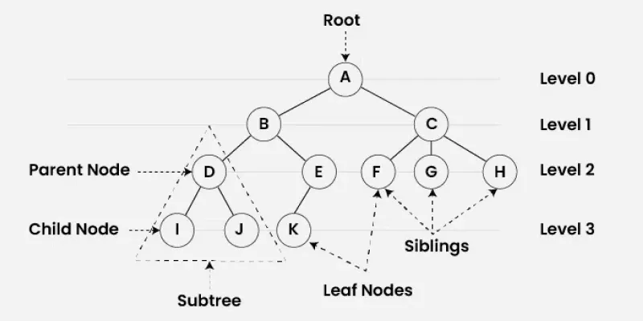

### Structure:

- **Parent Node:** Direct predecessor of another node.
- **Child Node:** Direct sucessor of another node.
- **Root Node:** Topmost node with no parent.
- **Leaf Node:** Node with no children.
- **Ancestors of a node:** All nodes on the path from the root to that node (including the node itself).
- **Sibling:** Nodes sharing the same parent.
- **Level:** Number of edges from the root.
- **Internal Node:** Node with at least one child.
- **Neighbor:** Parent or child of a node.
- **Subtree:** A node and all its descendants.

### Types:

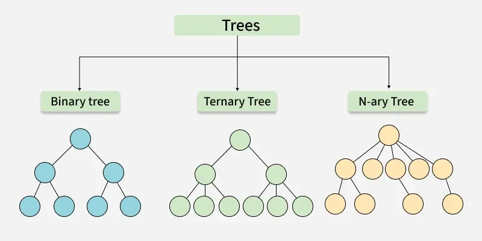

1. **Binary Tree:** A binary tree is a tree data structure where each node has at most two children. These two children are usually referred to as the left child and right child.
2. **Ternary Tree:** A Ternary Tree is a tree data structure in which each node has at most three children. These three children are usually referred to as the left child, mid child and right child.
3. **N-ary Tree:** An N-ary tree is a generalization of a binary tree, such that each node can have at most N children

### Tree Traversal Algorithms:

- Tree traversal refers tot he process of visiting all nodes in a tree in a specific order. It is generally divided into two main categories:

- **Depth-First Search (DFS):** Fully explores one branch before moving to the next.
  - Pre-Order (NLR): `Node -> Left -> Right`
  - In-Order (LNR): `Left -> Node -> Right`
  - Post-Order (LRN): `Left -> Right -> Node`

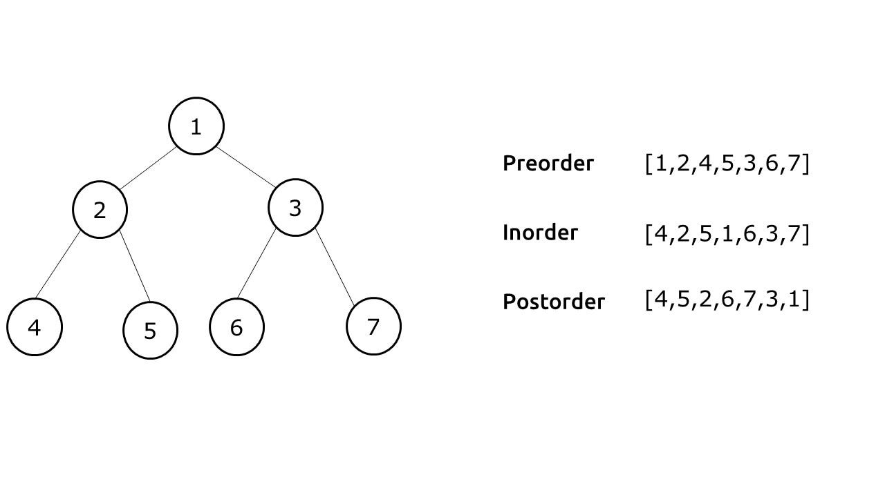

- **Breadth-First Search (BFS):** Visits nodes level by level across the tree.
  - Level-Order: Traverses nodes from top to bottom, often applied in shortest path algorithms.

### Binary Search Tree (BST):

- A Binary Search Tree is a specialized form of a binary tree in which each node follows a specific ordering property.
- It is designed to allow efficient searching, insertion, and deletion operations. The properties of a BST are:
  - The left subtree of a node contains only nodes with keys less than the node's key (root node).
  - The right subtree of a node contains only nodes with keys greater than the node's key (root node).
  - Both the left and right subtrees must themselves be binary search trees.

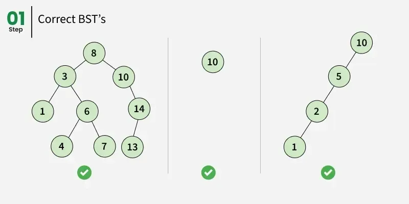

### Breadth-First Search (BFS):

- BFS and Level-Order Traversal are essentially the same traversal technique when applied to a tree.
- They visit nodes level by level, from left to right, starting from the root.

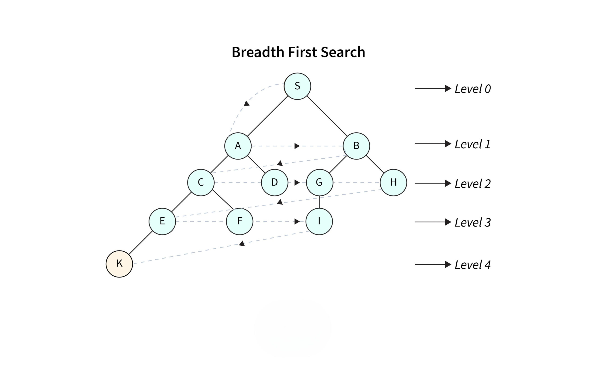

### Node insertion:

1. Start from the root.
2. Compare value with the current node's value:
   - If x < current node's value -> go to the left subtree.
   - If x > current node's value -> go to the right subtree.
3. Repeat until you find a `nullptr`, that's where the new node should go.
4. Insert the new node there.

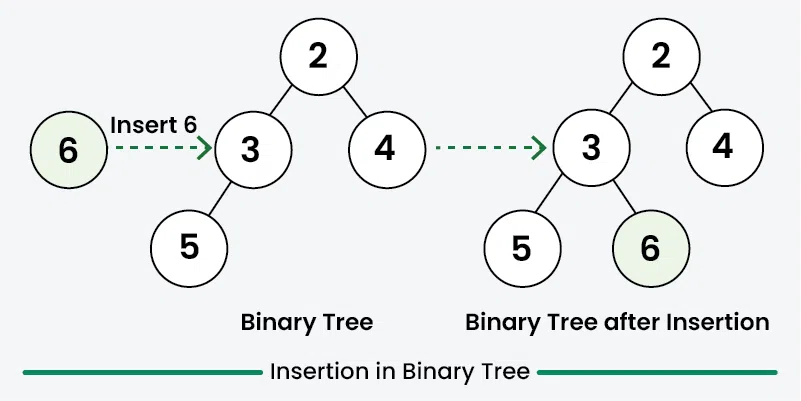

### Node deletion:

#### BST has three cases:

1. If node is leaf node, delete node directly

- Simply delete the node.
- Set its parent's pointer (left/right) to `nullptr`.

2. If the node has one child:

- Link the parent of the node to the node's only child
- Delete the node

3. If the node has two children (left and right):

- Find the inorder successor, the smallest value in the right subtree.
- Copy the successor's value into the node to delete.
- Delete the successor node.

### C++ Implementation (BST):

```cpp
#include <iostream>
#include <queue>
#include <stack>

using namespace std;

template<typename T>
class Node {
    public:
    T key;
    Node<T> *left;
    Node<T> *right;

    Node() {
        key = T();
        left = nullptr;
        right = nullptr;
    }

    Node(T key) {
        this->key = key;
        left = nullptr;
        right = nullptr;
    }
};

template<typename T>
class Tree {
    private:
    Node<T> *root;

    public:
    Tree() {
        root = nullptr;
    }

    /// Adds a node to the tree, following the specific ordering property of a BST. Time complexity: `O(n)`. Space complexity: `O(1)`.
    void add_node(T key) {
        Node<T> *new_node = new Node(key);

        if (root == nullptr) {
            root = new_node;
            return;
        }

        Node<T> *ptr = root;
        Node<T> *parent = nullptr;

        while (ptr != nullptr) {
            parent = ptr;
            if (key > ptr->key)
                ptr = ptr->right;
            else
                ptr = ptr->left;
        }

        if (key > parent->key)
            parent->right = new_node;
        else
            parent->left = new_node;
    }

    /// Traverses the tree using using DFS, in NLR order. Time complexity: `O(n)`. Space complexity `O(n)`.
    void preorder(Node<T> *ptr) {
        if (ptr == nullptr)
            return;

        cout << ptr->key << " ";
        preorder(ptr->left);
        preorder(ptr->right);
    }

    /// Traverses the tree using using DFS, in LRN order. Time complexity: `O(n)`. Space complexity `O(n)`.
    void postorder(Node<T> *ptr) {
        if (ptr == nullptr)
            return;

        postorder(ptr->left);
        postorder(ptr->right);
        cout << ptr->key << " ";
    }

    /// Traverses the tree using using DFS, in LNR order. Time complexity: `O(n)`. Space complexity `O(n)`.
    void inorder(Node<T> *ptr) {
        if (ptr == nullptr)
            return;

        inorder(ptr->left);
        cout << ptr->key << " ";
        inorder(ptr->right);
    }

    /// Traverses the tree using BFS, by levels. Time complexity: `O(n)`. Space complexity `O(n)`.
    void leveled() {
        if (root == nullptr)
            return;

        queue<Node<T> *> q;
        q.push(root);

        while (!q.empty()) {
            Node<T>* ptr = q.front();
            q.pop();

            cout << ptr->key << " ";
            if (ptr->left != nullptr)
                q.push(ptr->left);

            if (ptr->right != nullptr)
                q.push(ptr->right);
        }
    }

    /// Displays each of the data stored in the BST depending on the input parameter:
    /// 1. Preorder
    /// 2. Inorder
    /// 3. Postorder
    /// 4. Level by level
    /// Time complexity: `O(n)`. Space complexity: `O(n)`.
    void visit(int option) {
        switch (option) {
        case 1:
        // Preorder
        preorder(root);
        break;
        case 2:
        // Inorder
        inorder(root);
        break;
        case 3:
        // Postorder
        postorder(root);
        break;
        case 4: {
            // Level by level
            leveled();
            break;
        }
        default:
            break;
        }
        cout << endl;
    }

    /// Returns the tree height using BFS. Time complexity: `O(n)`. Space complexity: `O(w)`, worst case `O(n)`. Where `w` is the width of the tree.
    int height() {
        if (root == nullptr)
            return 0;

        queue<Node<T> *> q;
        q.push(root);

        int h = 0; // height counter
        while (!q.empty()) {
            h++;
            // Add all nodes in the level to the queue before incrementing height by 1 again
            int levelSize = q.size();
            for (int i = 0; i < levelSize; i++) {
                Node<T>* ptr = q.front();
                q.pop();

                if (ptr->left != nullptr)
                    q.push(ptr->left);
                if (ptr->right != nullptr)
                    q.push(ptr->right);
            }
        }

        return h;
    }

    /// Prints the ancestors of a key in a BST. Time complexity: `O(h)`, worst case `O(n)`. Space complexity: `O(h)`, worst case `O(n)`. Where `h` is the height of the tree.
    void ancestors(T key) {
        if (root == nullptr)
            return;

        stack<Node<T> *> s;

        Node<T> *ptr = root;
        while (ptr != nullptr && ptr->key != key) {
            s.push(ptr);
            if (key > ptr->key)
                ptr = ptr->right;
            else
                ptr = ptr->left;
        }

        if (ptr == nullptr) {
            cout << "Key was not found in tree." << endl;
            return;
        }

        while (!s.empty()) {
            Node<T> *top = s.top();
            cout << top->key << " ";
            s.pop();
        }

        cout << endl;
    }

    /// Returns the level of a key using BFS, or -1 if the key is not found. Time complexity: `O(n)`. Space complexity: `O(w)`, worst case `O(n)`. Where `w` is the width of the tree.
    int levelOf(T key) {
        if (root == nullptr)
            return -1;

        if (root->key == key)
            return 0;

        queue<Node<T> *> q;
        q.push(root);

        int level = 0;
        while (!q.empty()) {
            int levelSize = q.size();
            for (int i = 0; i < levelSize; i++) {
                Node<T> *ptr = q.front();
                q.pop();

                if (ptr->key == key)
                    return level;

                if (ptr->left != nullptr)
                    q.push(ptr->left);
                if (ptr->right != nullptr)
                    q.push(ptr->right);
            }
            level++;
        }

        return -1;
    }

    /// Deletes the node from the tree containing the given key. Time complexity: `O(n)`. Space complexity: `O(1)`.
    void delete_node(T key) {
        if (root == nullptr)
            return;

        Node<T>* ptr = root;
        Node<T>* parent = nullptr;

        while (ptr != nullptr) {
            if (ptr->key == key)
                break;

            parent = ptr;

            if (key > ptr->key)
                ptr = ptr->right;
            else
                ptr = ptr->left;
        }

        if (ptr == nullptr)
            return;

        // Case 3: node has two children
        if (ptr->left != nullptr && ptr->right != nullptr) {
            Node<T>* successor_parent = ptr;
            Node<T>* successor = ptr->right;

            while (successor->left != nullptr) {
                successor_parent = successor;
                successor = successor->left;
            }

            ptr->key = successor->key;

            Node<T>* successor_child = successor->right;

            if (successor_parent->left == successor)
                successor_parent->left = successor_child;
            else
                successor_parent->right = successor_child;

            delete successor;
            return;
        }

        // cases 1 and 2: node is leaf or only has one child
        Node<T>* child;

        if (ptr->left != nullptr)
            child = ptr->left;
        else
            child = ptr->right;

        if (parent == nullptr)
            // if parent is nullptr, it means the key is in the root
            root = child;
        else if (parent->left == ptr)
            parent->left = child;
        else
            parent->right = child;

        delete ptr;
    }
};
```

e.g:

```cpp
int main() {
    // Instantiate tree and add nodes
    Tree<int> tree;
    tree.add_node(8);
    tree.add_node(3);
    tree.add_node(10);
    tree.add_node(1);
    tree.add_node(6);
    tree.add_node(5);
    tree.add_node(14);
    tree.add_node(4);
    tree.add_node(7);
    tree.add_node(13);
    tree.delete_node(5);

    // 1. Tree traversals
    cout << "Preorder Traversal: ";
    tree.visit(1);

    cout << "Inorder Traversal: ";
    tree.visit(2);

    cout << "Postorder Traversal: ";
    tree.visit(3);

    cout << "Level Traversal: ";
    tree.visit(4);

    // 2. Tree height
    cout << "The tree height is: " << tree.height() << endl;

    // 3. Ancestors of a node
    cout << "Ancestors of node with key 4: ";
    tree.ancestors(4);

    // 4. Level of a node
    cout << "Level of node with key 14: " << tree.levelOf(14) << endl;
    return 0;
}
```

OUTPUT:

```
Preorder Traversal: 8 3 1 6 4 7 10 14 13
Inorder Traversal: 1 3 4 6 7 8 10 13 14
Postorder Traversal: 1 4 7 6 3 13 14 10 8
Level Traversal: 8 3 10 1 6 14 4 7 13
The tree height is: 4
Ancestors of node with key 4: 6 3 8
Level of node with key 14: 2
```

### Types of Binary Tree

| Classification              | Type                                | Description                                                                                                                                                                                                                | Diagram                                                                                                                                                                                    |
| --------------------------- | ----------------------------------- | -------------------------------------------------------------------------------------------------------------------------------------------------------------------------------------------------------------------------- | ------------------------------------------------------------------------------------------------------------------------------------------------------------------------------------------ |
| Based on number of children | **Full Binary Tree**                | Every node has 0 or 2 children. Equivalently, every non-leaf node has two children.                                                                                                                                        | 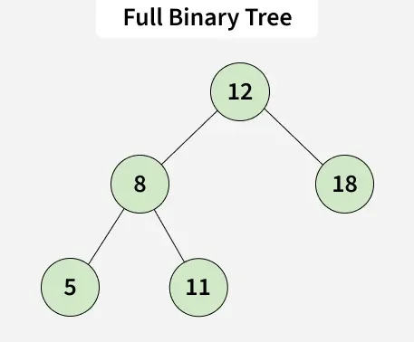                                                                                                                    |
| Based on number of children | **Degenerate Binary Tree**          | Every internal node has one child. Its performance is similar to a linked list. A degenerate or pathological tree has a single child, either left or right.                                                                | 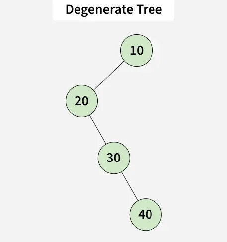                                                                                                        |
| Based on number of children | **Skewed Binary Tree `O(n)`**       | A pathological or degenerate tree dominated by left or right nodes. The two types are left-skewed and right-skewed.                                                                                                        | 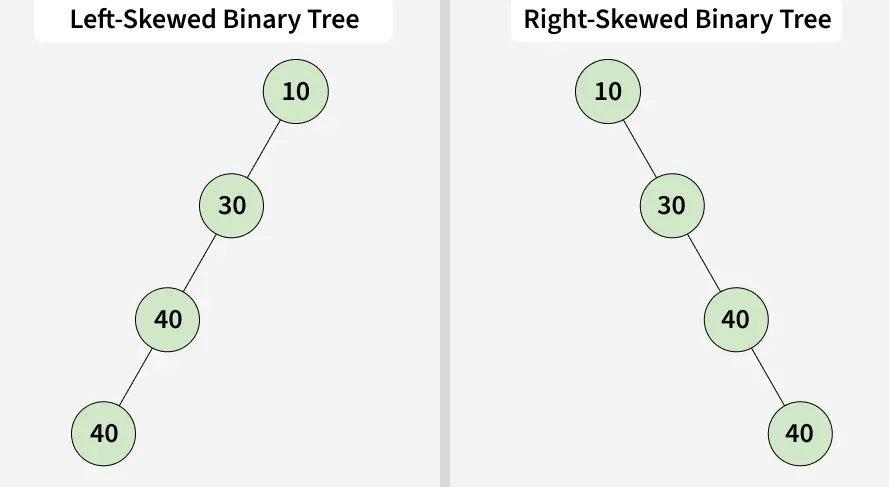                                                                                                                |
| Based on level completion   | **Complete Binary Tree**            | All levels are completely filled, except possibly the last, which is filled from left to right.                                                                                                                            | 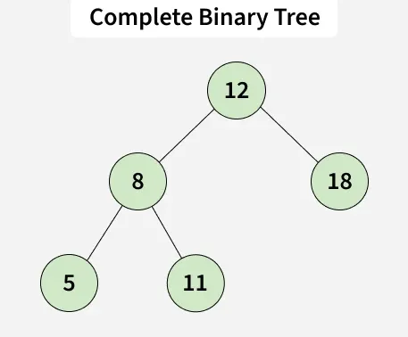                                                                                                            |
| Based on level completion   | **Perfect Binary Tree**             | All internal nodes have two children, and all leaf nodes are at the same level.                                                                                                                                            | 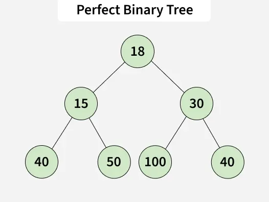                                                                                                              |
| Based on level completion   | **Balanced Binary Tree `O(log n)`** | The tree’s height is `O(log n)`, where `n` is the number of nodes.                                                                                                                                                         | 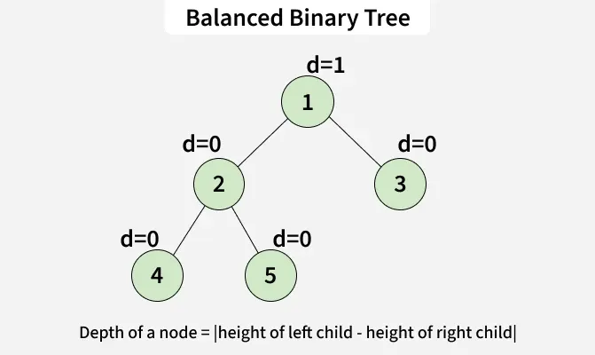                                                                                                            |
| Other special types         | **Heap Tree**                       | A complete binary tree that satisfies the heap property.<br><br> **Min-heap:** each child’s value is greater than or equal to its parent’s.<br><br>**Max-heap:** each child’s value is less than or equal to its parent’s. | Min-heap: 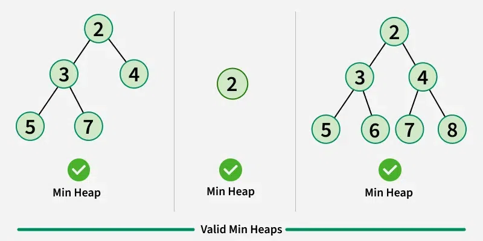<br><br>Max-heap: 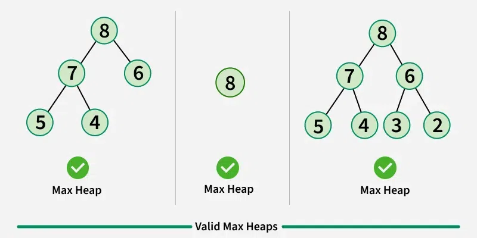 |
| Other special types         | **AVL Tree**                        | A self-balancing Binary Search Tree (BST) where the difference between the heights of the left and right subtrees of every node is at most 1.                                                                              | 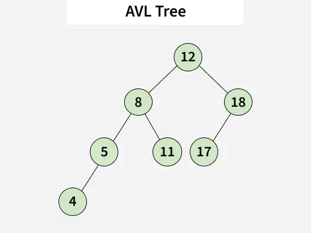                                                                                                                      |

A binary heap is typically represented as an array:

```
Left(i) = i*2 + 1
Right(i) = i*2 + 2
Parent(i) = floor((i-1)/2)
```

### Rotations:

#### 1. Left-Left Case:

- Occurs when a node is inserted into the left subtree of the left child, causing the balance factor to become more than +1.
- Fix: Perform a single **right** rotation.

#### 2. Right-Right Case:

- Occurs when a node is inserted into the right subtree of the right child, making the balance factor less than -1.
- Fix: Perform a single **left** rotation.

#### 3. Left-Right Case:

- Occurs when a node is inserted into the right subtree of the left child, which disturbs the balance factor of an ancestor node, making it left-heavy.
- Fix: Perform a left rotation on the left child, followed by a right rotation on the node.

#### 4. Right-Left Case:

- Occurs when a node is inserted into the left subtree of the right child, which disturbs the balance factor of an ancestor node, making it right-heavy.
- Fix: Perform a right rotation on the right child, followed by a left rotation on the node.

[↑ Back to NLDS Types](#types)
